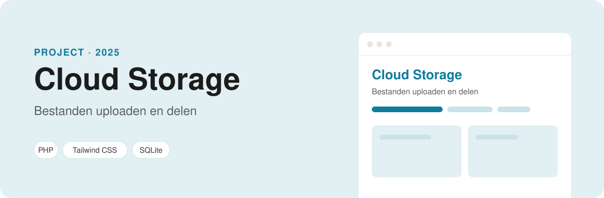

<p align="center">
  
</p>

<p align="center">
  
  
  
  
</p>

# Cloud Storage

Een soort mini Google Drive. Je logt in, uploadt je bestanden, bekijkt en verwijdert ze, en deelt ze met andere gebruikers via hun e-mailadres. Hier leerde ik hoe je uploads veilig afhandelt en hoe je regelt wie welk bestand mag zien.

## Functies

- **Account aanmaken en inloggen**. Wachtwoorden worden versleuteld opgeslagen met `password_hash`.
- **Uploaden**: JPG, PNG, GIF, PDF en DOCX. Andere bestandstypes worden geweigerd.
- **Je eigen bestanden** bekijken, downloaden en verwijderen (`home.php`). Je kunt alleen je eigen bestanden verwijderen.
- **Delen** met een andere gebruiker op e-mailadres, en de bestanden openen die met jou gedeeld zijn (`share.php`). Je kunt alleen je eigen bestanden delen.
- **Admin-pagina** met het aantal gebruikers in een grafiek (Chart.js). Alleen gebruikers met de rol `admin` komen erin.
- Alle databasequery's gebruiken **prepared statements** (PDO, met SQLite).

## Zelf draaien

Je hebt alleen PHP nodig (bijvoorbeeld XAMPP); een database hoef je niet in te stellen. De site gebruikt **SQLite**: bij het eerste bezoek maakt hij zelf `files/private/database.sqlite` aan, met de voorbeelddata uit `files/private/database.sql`.

1. Clone het project in de map van je webserver:
   ```bash
   git clone https://github.com/ParisAngelopoulos/cloud-storage2.git
   ```
2. Ga naar http://localhost/cloud-storage2/files en log in met een testaccount.

Geüploade bestanden komen in `files/uploads/`. Wil je opnieuw beginnen met alleen de voorbeelddata? Verwijder dan `files/private/database.sqlite`.

### Testaccounts

In de database staan al bestanden en gedeelde bestanden, zodat je meteen kunt rondkijken.

| Gebruikersnaam | Wachtwoord | Wat je ziet |
| --- | --- | --- |
| `admin` | `admin123` | De admin-pagina met het aantal gebruikers |
| `paris` | `welkom123` | Een cv en een vakantiefoto, plus 3 bestanden die met hem gedeeld zijn |
| `sanne` | `welkom123` | Een rooster en notulen |
| `daan` | `welkom123` | Een logo-ontwerp, plus 2 gedeelde bestanden |

## Mappen

| Bestand | Wat het doet |
| --- | --- |
| `files/index.php` | Inloggen |
| `files/register.php` | Account aanmaken |
| `files/home.php` | Je bestanden en het uploadformulier |
| `files/upload.php` | Controleert en bewaart een upload |
| `files/share.php` | Bestanden delen en gedeelde bestanden bekijken |
| `files/admin_page.php` | Overzicht voor de admin |
| `files/private/` | De database en `database.sql` met de tabellen en voorbeelddata (niet via het web te openen) |

---

Gemaakt door **Paris Angelopoulos**, web developer in opleiding · [GitHub](https://github.com/ParisAngelopoulos) · [parisangelopoulos@gmail.com](mailto:parisangelopoulos@gmail.com)
